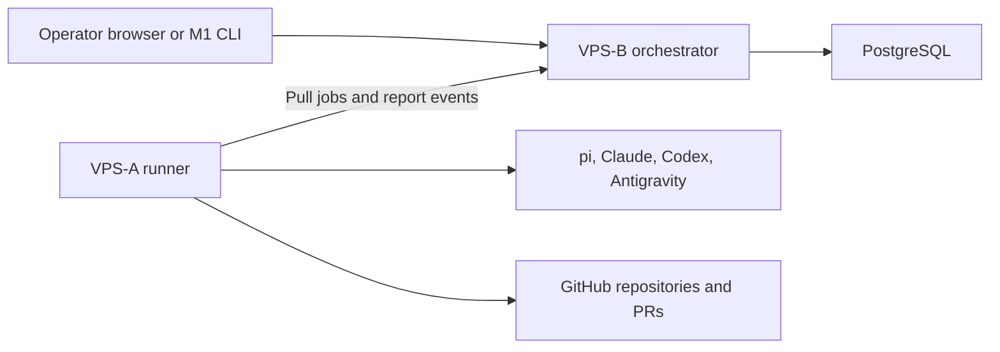

# Cursus — Design Document

| Field | Value |
| --- | --- |
| Document | 1 of the Cursus specification set |
| Version | 0.1.0 |
| Date | 2026-11-19 |
| Status | Draft |
| Baseline | Project Brief Cursus v1.2.0 and confirmed interview rounds 1–3 |

## 1. Overview & Goals

Cursus takes a single operator's spec through planning, execution, verification, and independent review. It delivers reviewed GitHub pull requests for coding work and reviewed files for non-coding work. An ordinary run requires the operator to supply the spec and judge the final result. Guided intake, optional steering, and exceptional recovery remain available.

VPS-B coordinates work and serves the private browser control surface. VPS-A executes pi and the three frontier CLIs. The authoritative coordination record survives a control-plane restart and lets the existing runner reconcile work after a disconnect. The project should remain a small Python application and runner with PostgreSQL as its only coordination store.

This document fixes system behavior, authority, and operating boundaries. The technical specification will define implementation contracts. The separate ReUI pass supplies the visual reference for the browser surface.

## 2. Requirements Summary

### 2.1 Sources and precedence

**B** refers to Project Brief Cursus v1.2.0 and the named section following it. **I** refers to confirmed interview decisions recorded in that revision, including the absence of a shipped frontend client. Requirements below are binding. Paragraphs tagged **[PROPOSED DESIGN DECISION]** need approval with this draft. **[ASSUMPTION]** identifies an operating premise. **[CONFLICT]** records a mismatch and its disposition.

### 2.2 Binding requirements

| ID | Requirement | Source | Sections honoring it |
| --- | --- | --- | --- |
| R01 | Single operator. Normal execution from a supplied spec through internal review is autonomous. Accept browser or repository-file intake, guided interviews, and optional steering. Support one-shot, single-ticket, multi-package, and iterative debugging work. | B Goal and operator contract; B What the system must do; I | §§3–6, 9 |
| R02 | Production work uses pi. Default to OpenCode Go, `deepseek-v4.1-flash`, and adjustable provider, model, and reasoning effort. Frontier work is organizational only. Invoke `claude`, `codex exec`, and mandatory `agy -p` directly. No OpenRouter, meta-harness, adapter layer, provider abstraction, runtime provider failover, rotation, or quota/spend routing. | B Hard constraints | §§3–4, 7–10 |
| R03 | VPS-B hosts the orchestrator, browser surface, and sole PostgreSQL store. VPS-A runs CLIs, worktrees, builds, and tests. MyPC and Chromebook are browser clients in v1. Only private tailnet access. | B Topology; B Scope; I | §§3, 6–9 |
| R04 | Orchestrator is the sole coordination hub and database client. Store prompts, answers, transitions, and evidence references. Runners pull jobs, keep durable local records and spool, and replay events idempotently. Sessions communicate through orchestrator handoffs. PostgreSQL supplies transactional claims and wakeups. | B Transport between sessions; B Decisions / Coordination state store and Transport between machines | §§3–6, 8–10 |
| R05 | Missed heartbeats indicate runner liveness. Ownership remains until evidence supports resolving the attempt, or the operator explicitly abandons an unrecoverable unknown outcome. No expiry-based requeue. Retries use separate worktrees and branches. | B Decisions / Coordination state store; I | §§3–6, 9–10 |
| R06 | Who can do what is determined by versioned roles, prompts, allowed tools, and limits. The orchestrator creates every delegation. Verify on evidence, review independently, bound repairs, and park exhausted work. | B Decisions / Role registry, Delegation inside pi, and Frontier reviewer; B What the system must do | §§3–7, 9–10 |
| R07 | Only trusted, operator-authorized GitHub repositories. Cursus may push its work branches, integrate accepted work on integration branches, and open PRs. Final merge belongs to the operator. Coding and debugging end with verified PRs. | B Topology; B Goal and operator contract; I | §§3–7, 9–10 |
| R08 | Marketing, grants, and business development/planning ship as built-in workflows sharing the core. Deliver reviewed files. Publication, submission, and outreach are outside Cursus authority. A general plugin system is outside v1. | B Goal and operator contract; B Scope; B Milestones; I | §§3–7, 9–10 |
| R09 | Optional adversarial review for plans and specs. Three distinct frontier seats, fresh sessions, recorded structured objections and verdicts, and a hard cap of three rounds. Spec-mode questions go through interview intake. | B Decisions / Adversarial review protocol | §§3–6, 9 |
| R10 | Existing browser over a private address, with FastAPI, uvicorn, Jinja2, htmx, and SSE. No installed client, frontend build, or React bundle. UI visuals belong to the later ReUI reference. Show live progress, logs, parked work and available spend data. | B Decisions / Control surface stack; B What the system must do; I | §§3–4, 6–9 |
| R11 | Use Python for Cursus, complete files, thorough comments and error handling, American English, SemVer and changelog from first commit. Keep actively maintained permissive dependencies few. Target a small fraction of the roughly 100k-line ceiling. Under 500 lines per file is the norm, and over 1,000 signals refactoring. Each module maps to a brief function. | B Scope | §§4, 8, 10 |
| R12 | Demonstrate five-package autonomous delivery on real work, restart/disconnect recovery, collision-free parallel work, iterative debugging to a fix, and usable marketing and grant deliverables. Tag usable milestones. Nightly PostgreSQL dump via Hermes. | B Success criteria; B Milestones; B Decisions / Coordination state store | §§8–9 |

**[ASSUMPTION]** The brief's token volume figure guides workload planning. Actual concurrency is constrained by VPS-A capacity and measured CLI behavior. The brief sets no numeric throughput, response-time, or cost target. Spend and usage are observational.

## 3. System Architecture

The runner initiates tailnet exchanges. The control plane receives runner events and returns jobs and commands. The operator surface reads durable state and submits commands through the same orchestrator. GitHub carries source, branches, and PRs. Any tracking issue is an optional projection of committed phase state. Providers receive requests through their designated CLI on VPS-A.

**[PROPOSED DESIGN DECISION] Normal run.** Commit the intake source and its revision, then enqueue the appropriate planning job. Validate the returned plan before queuing ready work. Validate package IDs, dependency existence and acyclicity, and typed criteria with an executable verification method and expected result. Dispatch only ready work. Each worker result becomes a candidate. Verification and independent review evaluate that candidate, and accepted changes advance through integration. A successful integration releases dependent work. A failed gate drives bounded repair or a visible parked state. Publish the resulting PRs or reviewed files and commit the handoff references before declaring the phase delivered.

**Dependencies and integration [PROPOSED DESIGN DECISION].** Execute packages with satisfied dependencies in parallel, pinning each attempt to the integrated phase revision it received. Use a phase integration branch initialized from the selected target commit. Serialize writes to it in one durable publication sequence per phase. Evaluate a reviewed package against the current integration head in a separate integration worktree. For a candidate built on an older phase head, verify the combined result before advancing the integration branch. A material change to the package patch requires a new review. An integration conflict is explicit repair work through pi with bounded retries and fresh verification and review. Never advance a branch using unverified combined changes. Each integration update must verify that the previous remote head still matches its recorded expected head. Publish the PR only after all required packages are integrated and phase checks pass against the exact proposed head. If the target branch has moved before publication, revalidate the proposed result against the new target before handoff. As a default, publish one PR per coding phase or debugging run. Multiple PRs require explicitly defined independent outputs with separate integration state.

**Ownership and restart.** The orchestrator owns claims. The runner owns local execution and records launch identity, progress and terminal outcome before reporting them. An orchestrator restart or dropped link leaves the existing runner and attempt intact. A restored connection reconciles committed claims, runner records, and replayed events before replacement work can be dispatched. §9 defines the recovery outcomes.

**Workflow variation [PROPOSED DESIGN DECISION].** A one-shot or single-ticket spec can use one package while still passing verification and independent review. A debug run is an iterative diagnosis and repair session using pi RPC. It can reproduce, investigate, revise and rerun checks in the same attempt, or start bounded follow-up attempts when repair or interruption requires them. It reaches successful handoff only with evidence of a fix and a PR. The three non-code workflows use the same attempt and review machinery with built-in criteria and artifact production steps chosen by their specs.

**[CONFLICT]** The brief describes a workflow extension mechanism and excludes a plugin system. Resolve with built-in, repository-versioned workflow definitions and Python behavior shipped as part of Cursus. New workflows are ordinary source changes. §4 assigns these definitions a caller.

## 4. Component Responsibilities

| Component | Runs on | Responsibility and caller | Brief function |
| --- | --- | --- | --- |
| Operator HTTP and command-line entry points | Browser on operator devices. M1 command-line intake on VPS-B under an authorized local operator account. | Accept intake, interview replies, steering and recovery actions. Query state, stream events, and expose completed deliverables. Invoke orchestrator commands and queries. | 1, 10 |
| Orchestrator | VPS-B | Own phase and attempt lifecycles, workflow selection, queues, readiness and sequencing, debate rounds, verification and review verdicts, and recovery. On each eligible transition, invokes the relevant workflow step and writes the resulting job, state, and event in one transaction. | 1–9 |
| Built-in workflow definitions | VPS-B | Supply intake requirements, next steps, acceptable criteria and deliverable types for coding, debugging, marketing, grants, and business development/planning. The orchestrator selects the definition when it accepts intake. | 1–3, 5–9 |
| Role registry | VPS-B | Load and validate versioned TOML and Markdown. Resolve concrete invocation settings and prompt revisions when the orchestrator creates a job. | 2–3, 5, 7, 11 |
| Coordination store | VPS-B | Persist the authoritative event history and current states, claims, command records, and artifact/publication metadata. The orchestrator alone reads and writes it. | 4, 9–10 |
| Runner and local record | VPS-A | Pull and reconcile jobs, enforce capacity, start fixed CLI entry points, execute verified commands for builds/tests, apply authorized steering and cancellation, and spool evidence and events. The runner service polls the orchestrator. | 4–7, 10 |
| Worktree, verifier, and publisher operations | VPS-A | Prepare per-attempt directories, conduct controlled checks, integrate at a pinned head, push authorized refs, and create or reconcile GitHub PRs. The runner invokes these operations for explicit orchestrator jobs. | 5–9 |

The runner prepares a read-only snapshot of the candidate and its evidence for review. For code, the snapshot identifies the exact commit under review. For other work, it identifies the exact artifact digests. The role registry permits organizational roles on the authorized frontier CLIs and production roles on pi. A reviewer can be a distinct frontier session or a distinct pi session with read-only access. Reviewer prompts carry the applicable criteria and immutable candidate identity. Review verdict records identify the reviewer, candidate, criteria, findings and disposition. A candidate creator cannot also act as its reviewer. The runner directly starts the selected binary and normalizes its output at ingestion. Registry validation and interpretation of CLI events are internal Cursus responsibilities.

**[PROPOSED DESIGN DECISION]** One configured verification action may execute an operator-authorized repository command against the pinned candidate. A frontier proposal cannot itself authorize arbitrary commands. Each planned criterion must map to an approved executable check, a deterministic artifact check, or explicit reviewer judgment with named evidence and pass conditions. Require a structured completion report for production attempts. The report and exit status are supporting signals. Criteria, check results and independent verdict must agree for acceptance. Missing or malformed evidence fails that gate.

**Adversarial review.** The authoring model is advocate. The other two frontier models fill the critic and judge seats under configured fixed assignments. Each round records the plan and rationale, independent numbered objections with severity/evidence/fix, the advocate's response, the judge's rulings and required amendments, and the author's revised plan where required. Each seat invocation is fresh and receives only its prescribed inputs. Later rounds focus on upheld objections and amendment regressions. Judge acceptance or absence of upheld blockers ends the debate after any required final amendments are incorporated. Round three with unresolved blockers parks the review with its transcript. In spec mode, answers to judge questions update the durable spec revision before the next round.

## 5. Data Model

| Concept | Identity and authority | Key relationships and invariants |
| --- | --- | --- |
| Intake and spec revision | Orchestrator ID and revision in PostgreSQL | Immutable content or a GitHub repo/path/commit reference with the accepted content snapshot. Interview questions and replies link to the revision they informed. |
| Phase and plan revision | Phase ID and plan revision in PostgreSQL | Pin workflow, spec and role/prompt revision, repository and target where applicable, plan, limits and delivery state. A completed phase refers to delivered outputs. |
| Package and criterion | Package ID unique in phase, criterion ID unique in package | Dependency edges point to packages in the same plan. Criteria carry check type, expected result, and evidence requirements. |
| Job and attempt | Job ID and attempt ID in PostgreSQL | Job identifies an allowed action. An attempt records runner assignment, current ownership, role, base SHA, status, terminal evidence and originating job. Only one attempt may own a package's active execution at a time. |
| Runner and local execution record | Registered runner ID in PostgreSQL. Durable attempt records on VPS-A. | Runner contact state is tracked independently from attempt ownership. Local records bind a claim to its process or confirmed terminal outcome, workspace and spool progress. |
| Event and command | Event identity plus deduplication key. Durable command ID and target attempt. | Event log holds exchanged prompts, sanitized responses, transitions and consequences. Commands record requested, acknowledged and resolved outcomes. A delayed command targets the original attempt. |
| Evidence, review and artifact | Orchestrator IDs and immutable candidate references | Evidence records criterion, provenance and outcome. Artifact references carry identity, integrity information and location. Review verdicts bind to exactly the inputs reviewed. |
| Integration and publication | Phase integration reference and publication intent ID | Record intended base, head, accepted attempt IDs, sent operations and confirmed GitHub result. Only an authorized current intent can advance phase integration or create the PR. |

**[PROPOSED DESIGN DECISION] State vocabulary.** A phase progresses through intake, planning, execution, delivery and delivered. A package progresses through blocked or ready, active, verification, review, integration and integrated. Equivalent accepted outputs replace integration for non-code work. Parked and canceled outcomes are explicit and retain the reason. Attempt ownership, liveness, and completion are separate dimensions. A runner marked unreachable never changes an active package to ready. An unknown outcome is parked with ownership held. Abandonment invalidates that attempt's ability to advance the phase.

**[PROPOSED DESIGN DECISION] File residence.** Code remains in git and VPS-A worktrees. Transfer bounded non-code output and evidence files to a private VPS-B directory through the authenticated runner API, referencing them by immutable ID and digest in PostgreSQL. Complete and verify the file before committing a downloadable reference. A delivery with a required missing file cannot become delivered. The local spool is retained until the corresponding events are durably acknowledged. Capture event cursors and acknowledgement semantics in Document 2.

## 6. API & Interface Design

| Boundary | Required behavior | Failure and retry behavior |
| --- | --- | --- |
| Browser and M1 CLI → orchestrator | Submit or reference a spec, start a run, submit interview answers, inspect progress and evidence, and request allowed steering or recovery actions. Browser actions include download and review handoff. | A repeated mutation with the same request identity has one effect. State-changing requests validate current state and return the persisted disposition. |
| Browser → SSE | Subscribe to committed progress and worker log events for authorized runs. | Reconnect with a committed event cursor. If history is unavailable, resynchronize from the current persisted state before following new events. |
| Runner → orchestrator | Long-poll for a claim, heartbeat, reconcile held claims after reconnect, send ordered event batches, upload artifacts, and receive and acknowledge commands. Preserve brief endpoints `GET /jobs/next` and `POST /attempts/{id}/events`. | A lost claim response is recoverable by runner identity and pending claim disposition. A replayed event is deduplicated. Reject stale attempts for progression and retain the recovery disposition in the audit history. |
| Runner → local CLIs | Pass concrete versioned prompts, approved tools and context. Use pi RPC for long attempts and steering, pi JSON for one-shot roles, and structured non-interactive frontier invocations. | A tool prompt requiring forbidden approval, auth failure, missing terminal evidence, or incompatible output produces a classified outcome. Provider assignments stay fixed. |
| Runner publisher → GitHub | Read approved refs, push allowed attempt and integration refs, create or find the phase PR by recorded repository/head/base and record its returned identity. | After ambiguous responses, inspect the remote state before replay. A mismatched ref or unexpected head blocks publication until reconciled. |
| Orchestrator → PostgreSQL | Commit state, queue intentions and events atomically. Use transactional claims and persisted queue scans with notifications as wakeups. | Recovery scans committed state at startup and after wakeups or missed notifications. External mutations have durable intent records and can be reconciled independently of the DB transaction. |

**[PROPOSED DESIGN DECISION]** Keep runner leases out of the wire contract. Each claim has a unique attempt identity plus its assigned runner, tracked through reconciliation. A lost response cannot cause the same runner to start a job twice. The technical specification must distinguish an unacknowledged claim that never started from an uncertain execution and describe positive evidence required to clear either.

The browser contract includes intake, current and historical progress, live worker logs, parked reasons and allowed recovery, steering for eligible sessions, and output handoff. It uses same-origin server rendering and SSE. Layout, colors, navigation composition, and components are delegated to the ReUI pass.

## 7. Security Architecture

- **Browser identity.** Bind the HTTP service to loopback on VPS-B and publish through Tailscale Serve over HTTPS. Authorize only the configured operator login from Serve identity headers. Test forged headers, missing identity, and the actual desktop and Chromebook endpoints. Apply same-origin checks and CSRF protection to browser writes. Keep approval for exceptional abandonment scoped to the exact parked attempt. [Tailscale Serve identity headers](https://tailscale.com/docs/features/tailscale-serve#identity-headers)
- **Runner identity.** Each registered runner has its own bearer token, with claim, event, artifact and command access scoped to that runner. Store tokens outside Git and restrict file access. Runner endpoints require runner authentication even for a tailnet member. Only the orchestrator has DB credentials.
- **CLI boundaries.** M0 establishes separate CLI service users and credential renewal procedures. Give frontier processes read-only project inputs, no GitHub write credential, no writable execution worktree, and a private writable home for CLI state. Validate effective write denial, including via shell or tools, in M1. Only the configured pi roles perform production work. Contain CLI working directories, prohibit recursive agent delegation, and keep secrets out of prompts, logs and artifact metadata. Tool allowlists complement filesystem and process permissions.
- **GitHub authority [PROPOSED DESIGN DECISION].** Keep GitHub publication credentials in runner-owned publishing operations outside agent and verifier subprocesses. Enforce repository allowlisting and destination checks at that boundary. Permit push only to Cursus attempt and integration refs and authorize PR creation by exact repo/head/base. Target-branch writes and merge operations have no Cursus entry point. GitHub branch protection can provide additional enforcement where the target repository supports it. Never assume a repository-scoped credential enforces branch-prefix permissions. [GitHub branch protection](https://docs.github.com/en/repositories/configuring-branches-and-merges-in-your-repository/managing-protected-branches/about-protected-branches)
- **Input and evidence handling.** Treat repo content, CLI output, filenames, and artifacts as data. Validate structured payloads, escape display content, and restrict artifact paths to the approved storage area. Keep the runner's control token and DB/GitHub credentials out of build and test subprocess environments. Trusted repos remain the execution scope. Verify that allowed publication cannot trigger target-branch changes under enrollment settings.

## 8. Infrastructure & Deployment

| Host | Services and durable data |
| --- | --- |
| VPS-B, 4 vCores / 8 GB | FastAPI/uvicorn with coordinator loops in a single orchestrator service, PostgreSQL, private artifact directory, Tailscale Serve, and Hermes nightly backup scheduling. PostgreSQL uses numbered, repository-versioned SQL migrations. |
| VPS-A, 6 vCores / 12 GB | Python runner as a systemd service, CLI users and native CLI installations, local attempt records, JSONL spool, source cache and worktrees, and builds/tests. |
| MyPC and MyChromebook | Existing browser on the tailnet. MyPC stays a client for v1. |

**[PROPOSED DESIGN DECISION]** Use one orchestrator process in v1. Bind asyncpg connections locally. Keep request handling and wakeups independent of subprocess execution, with bounded job/event batch sizes and log fan-out. Set separate configurable worker and test concurrency bounds on VPS-A. Refuse additional claims when the runner cannot durably record execution. Show queue and capacity indicators. Establish initial bounds on the actual hardware with a saturated-worker smoke run.

**[PROPOSED DESIGN DECISION]** Treat PostgreSQL, artifact files and required runner records as separate restore concerns. Package the nightly PostgreSQL dump with the retained artifact files referenced by that backup, store backup copies outside VPS-B, and test a restore with the runner disconnected and then reconnecting. Avoid declaring unknown historical attempts complete after a backup restore. Replication and automatic host failover are outside the initial topology.

Use a versioned Python deployment, review and lock actively maintained permissive dependencies, and maintain the SemVer changelog from bootstrap. UI assets are server-rendered and served from the Python deployment with locally served htmx. The frontend adds no Node toolchain. CLI installation requirements remain on VPS-A and do not alter the browser deployment.

| Milestone | Release boundary |
| --- | --- |
| M0 | Establish tailnet host identity and access, repository/changelog, each CLI user and credential lifecycle, and non-interactive probes. |
| M1 | Run one package from command-line intake through PostgreSQL claim, pi worktree, verification, independent review, and PR. Validate external capabilities in §11 before depending on them. |
| M2 | Support multi-package phases, integration sequencing, parallel execution, iterative debugging, restart reconciliation, and optional plan/spec debate orchestration. |
| M3 | Ship browser intake, interviews, monitoring, downloads and steering on the private tailnet. The visual reference is supplied separately before UI implementation. |
| M4 | Ship marketing, grants, and business development/planning workflows over the common runtime. Demonstrate all v1 outcomes before release. |
| M5 | **[PROPOSED DESIGN DECISION]** Treat MyPC as a post-v1 optional second runner. Preserve runner identity in the v1 contract without implementing multi-machine scheduling. |

## 9. Operational Model

### 9.1 Recovery and cancellation

| Observation | Cursus action |
| --- | --- |
| VPS-B restarts or the tailnet link drops | Hold attempt ownership. Keep working and spooling on VPS-A where the CLI is still running. Mark runner reachability separately. Reconcile and replay on reconnect without requiring an operator. |
| Runner still has a live execution | Resume tracking its original attempt. Apply only unresolved commands addressed to it and acknowledge their actual disposition. |
| Runner has a durable terminal result | Replay the terminal result and its evidence. Verify or classify it using the original attempt identity. |
| Runner can prove an attempt stopped without a usable terminal result | Record interruption or confirmed cancellation. Release ownership after that evidence commits. Retry only where the action and configured budget allow it. An operator cancellation suppresses automatic retry of the canceled work. |
| Original attempt outcome remains unrecoverable | Park with ownership intact. Permit explicit operator abandonment only in this state. Record it before any replacement becomes eligible. A late result cannot advance the package, integration or delivery. |
| GitHub operation outcome is uncertain | Reconcile against the recorded immutable commit/ref or PR identity. Confirm the previous write or retry the same authorized intent. Park contradictions rather than guessing. |

**[PROPOSED DESIGN DECISION]** Distinguish runner restart from orchestrator restart. If runner restart ends the CLI, recover a durable terminal record or establish that the previous execution is stopped before treating it as interrupted. If a surviving process cannot be controlled or its outcome proven, keep ownership and follow the unknown-outcome path. Use attempt-specific worktrees and refs even after abandonment. Worker publication is limited to their own attempt refs, which cannot update an integration branch.

### 9.2 Normal operations and readiness

- Display queue depth, worker occupancy, latest runner contact, spool backlog, attempt failures, external provider or GitHub errors, and available token/spend figures. Unreported usage is unknown. Keep spend outside dispatch decisions.
- Pin run inputs and evidence to versioned specs, roles, prompts and commits. Credential renewal, version bumps and retention are operator-administered. Cleanup must preserve pending spool data and any artifact or evidence required by an active run or a retained handoff.
- Keep operator steering separate from execution completion. Pending steering and cancellation can remain unresolved across a disconnect. If a runner crash leaves an RPC delivery uncertain, record that disposition instead of blindly repeating a steering message. A UI or CLI action may report only the state the control plane has actually committed.
- Confirm on real work that one phase of at least five packages reaches reviewed PRs with zero intervention, a control-plane restart and tailnet disconnect preserve ownership and reconcile the spool, parallel workers leave isolated refs and serialized integration, a debugging run reaches a verified fix and PR, and marketing and grant runs return usable reviewed files. Also exercise recovery after proven interruption and explicit abandonment before calling the recovery behavior ready.

## 10. Key Design Decisions

| Decision | Reason and consequence |
| --- | --- |
| PostgreSQL with atomic state/event/queue writes | One authoritative store serves coordination, claiming, audit and restart. Notifications improve responsiveness. Persisted records determine behavior. |
| Pull-based runner, durable ownership and local spool | CLI lifetimes are independent of VPS-B and link health. **[COMPLEXITY JUSTIFICATION]** Durable runner evidence and explicit reconciliation are needed to preserve active work without treating a timeout as authority to rerun it. |
| Direct subprocess calls and one internal event format | Reuse native CLI auth and execution while giving the orchestrator one durable event contract. CLI-specific parsing and fixed command construction belong in the runner. |
| Attempt-isolated Git working state and serialized integration | Parallel production stays independent, and package evidence identifies exact inputs. **[COMPLEXITY JUSTIFICATION]** A durable publication intent bridges PostgreSQL and GitHub, where one shared transaction is unavailable. |
| Built-in workflows and versioned role inputs | Support first-release non-code workflows and reproducible role changes using reviewable source. |
| Private server-rendered browser surface | One deployable on VPS-B serves both operator devices. The ReUI pass determines the visual reference and the deployed pages use approved browser contracts. |

## 11. Open Questions & Assumptions

**[ASSUMPTION]** The operator has the requested subscriptions, controls the tailnet and allowed GitHub repositories, and can provision credentials for the VPS users. Cursus has outbound connectivity from VPS-A to required providers and GitHub. The runner's local disk and spool ordinarily survive network interruptions. A server loss can remove unacknowledged data and require the §9 recovery action.

**[CONFLICT]** Brief v1.2.0 names `agy -p --output-format json` and requires live worker events. Google documents `json` as a single completion object and `stream-json` as incremental events. **[PROPOSED DESIGN DECISION]** Keep mandatory direct invocation through `agy -p` and use `--output-format stream-json` subject to the installed-version M1 test. [Google Antigravity headless mode](https://antigravity.google/docs/cli/headless/)

| Verification gate | Proof required and consequence if absent |
| --- | --- |
| M0 CLI access on VPS-A | Each CLI can run under its assigned user with non-interactive credentials, and renewal is documented. An unavailable required credential blocks the affected milestone path. |
| M1 pi/OpenCode Go | Run pi with the configured OpenCode Go model in the intended one-shot and RPC modes. Demonstrate structured outputs, real allowed tool calls, the configured reasoning behavior, steering, abort and terminal detection. Verify against pinned versions. The advertised model endpoint does not by itself establish that pi and its tooling work. [OpenCode Go model endpoints](https://opencode.ai/docs/console/go#endpoints) |
| M1 frontier execution | Exercise the selected Claude, Codex and Antigravity builds for structured result/error handling and effective read-only project access in headless invocation. Ensure forbidden operations fail without waiting for operator input. A required CLI that cannot meet its contract blocks that path and triggers a spec revision or a supported configuration fix. |
| M1 deployed identity and GitHub scope | Use a minimal probe to prove Serve forwards the required operator identity on both browser devices ahead of M3. Verify separate runner credentials and demonstrate that repository enrollment can publish work and PRs within authorized destinations using the intended GitHub account configuration. |
| Document 2 engineering contracts | Specify event ordering and replay, durable claim/reconciliation and command acknowledgements, runner process supervision, integration intent recovery, supported criterion schemas, data limits and retention, named callers and type closure. Keep version-specific invocations contingent on the corresponding M0/M1 proof. |

## Revision History

| Version | Date | Changes |
| --- | --- | --- |
| 0.1.0 | 2026-11-19 | Initial draft grounded in Project Brief Cursus v1.2.0 and the confirmed interview. |

Review this and let me know when you're ready for Document 2.
